# Car Glass

Skrin utama "kaca" untuk head unit Android kereta. Speedometer GPS yang sporty, waktu solat, cuaca,
status Wi-Fi / Bluetooth / GPS, dan enam pintasan app yang boleh ditukar. Tema siang dan malam bertukar
mengikut matahari, dengan efek hujan.

> **Status: percubaan.** Diuji pada satu unit sahaja (lihat [docs/DEVICES.md](docs/DEVICES.md)).
> Anda bertanggungjawab ke atas unit anda sendiri. Launcher asal tidak dibuang dan boleh dipulihkan.

*English:* a touch-friendly Android launcher for car head units: sporty GPS speedometer, prayer times,
weather, Wi-Fi/Bluetooth/GPS status, six customisable app tiles, automatic day/night theme and a rain effect.
Experimental, tested on a single Mohawk RK3326 unit (Android 11).

## Galeri

Tangkap skrin sebenar daripada unit (1280x720, Wi-Fi dan nama tempat disembunyikan):

| Malam | Malam, laju | Hujan |
|---|---|---|
| 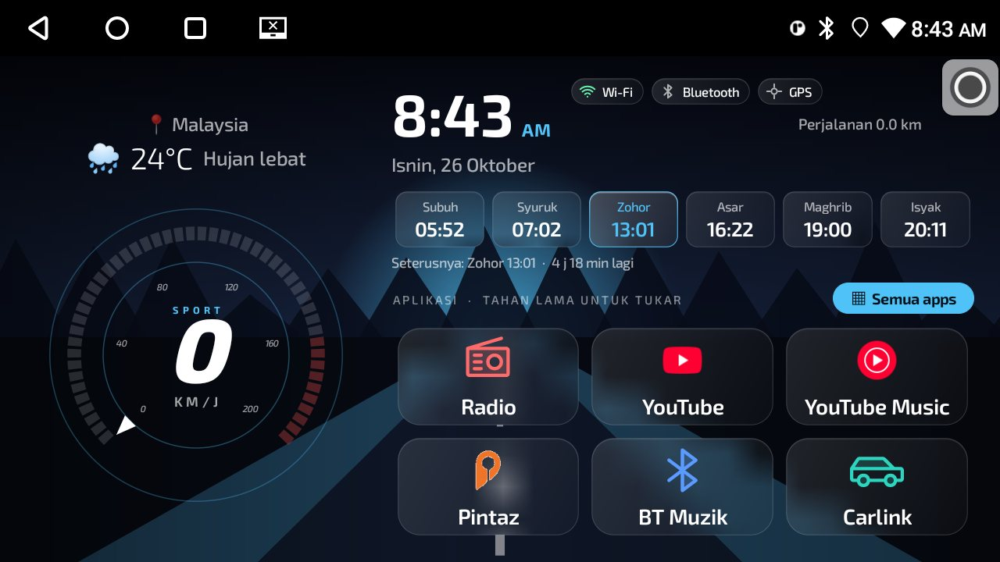 | 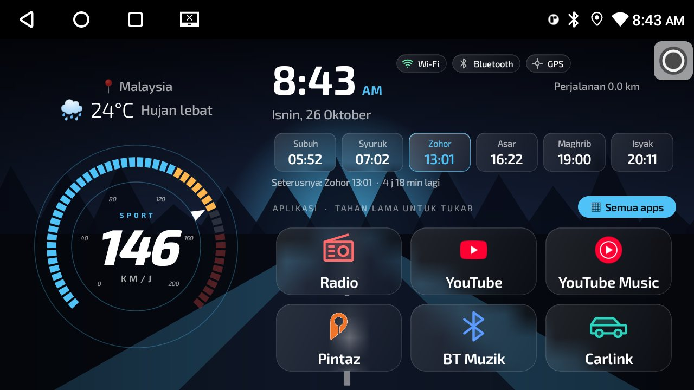 | 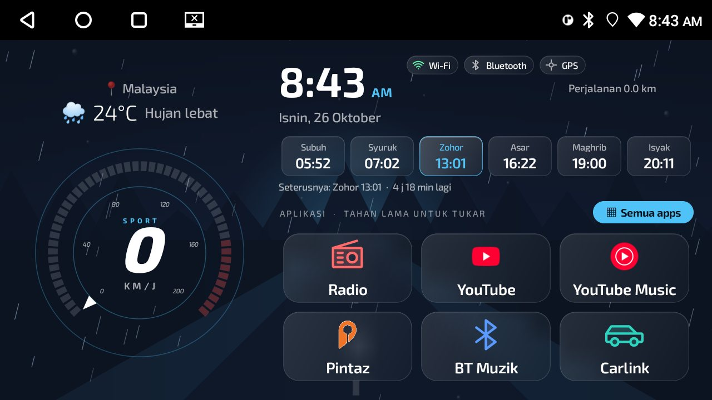 |
| **Siang** | **Siang, laju** | **Tukar app (tahan lama)** |
| 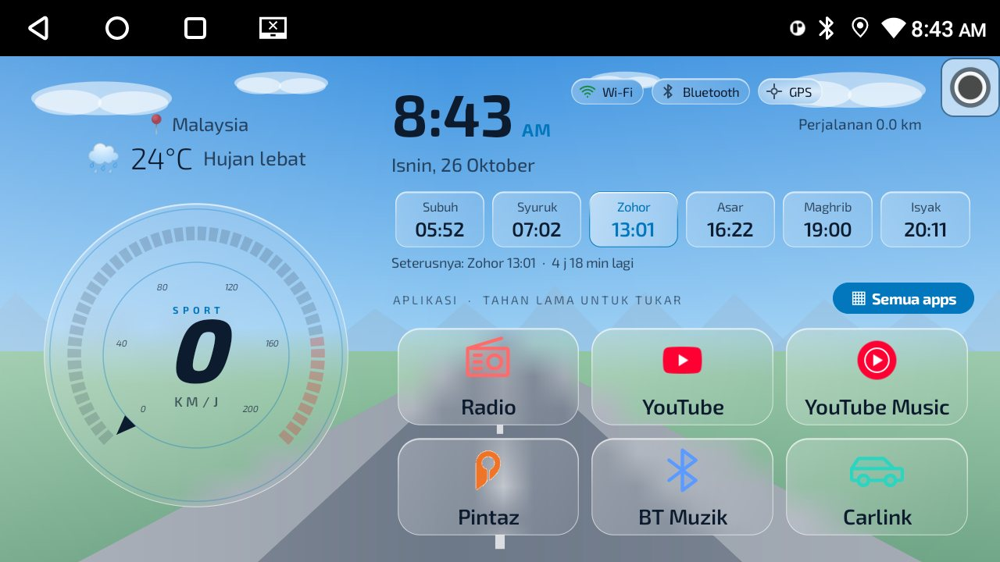 | 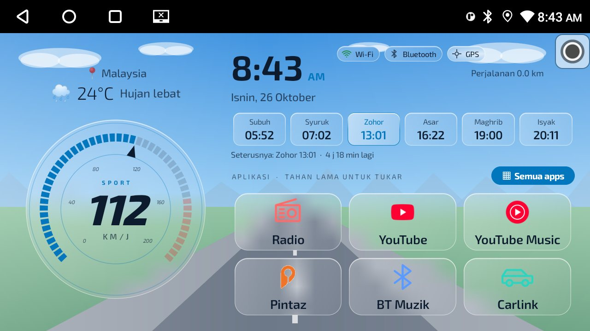 | 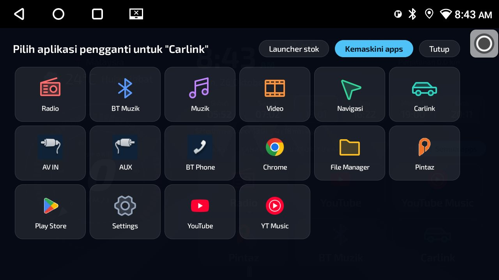 |
| **Semua apps (malam)** | **Semua apps (siang)** | **Splash** |
| 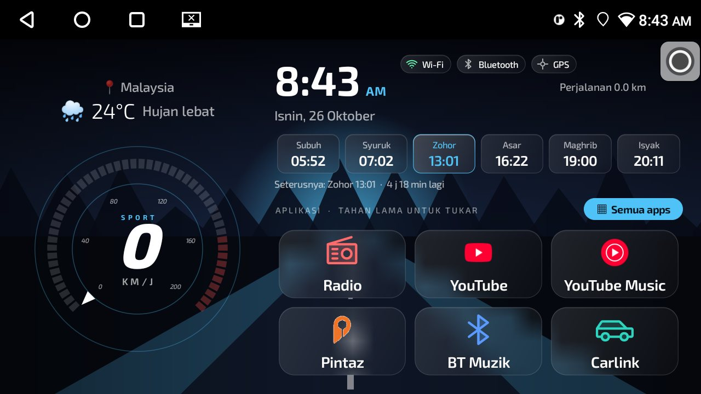 | 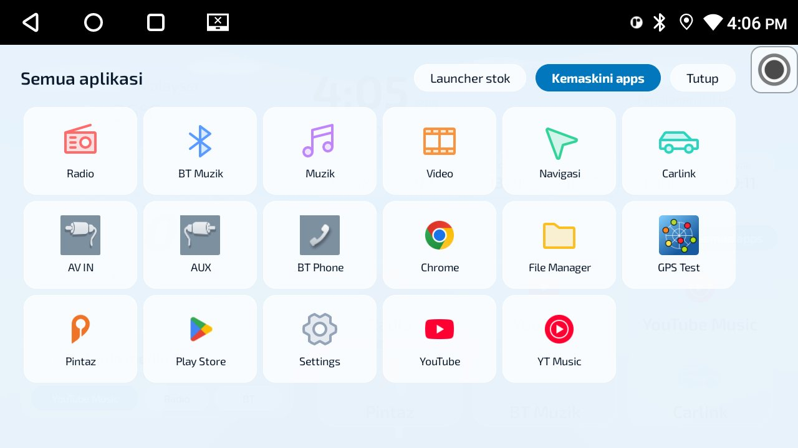 | 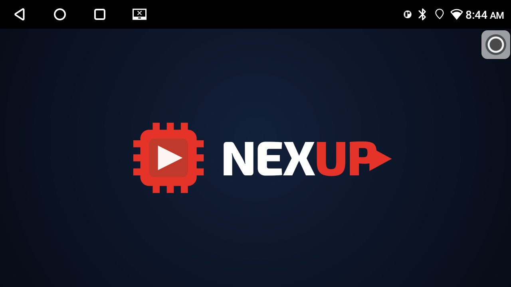 |
| **Kad media: YouTube** | **Kad media: tiada media** | |
| 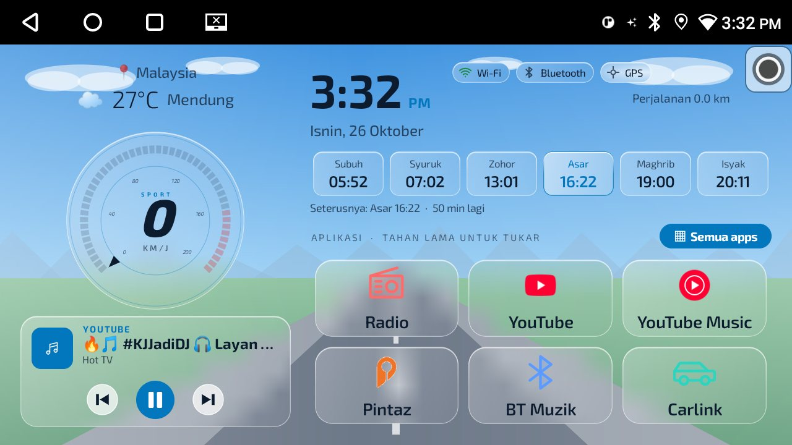 | 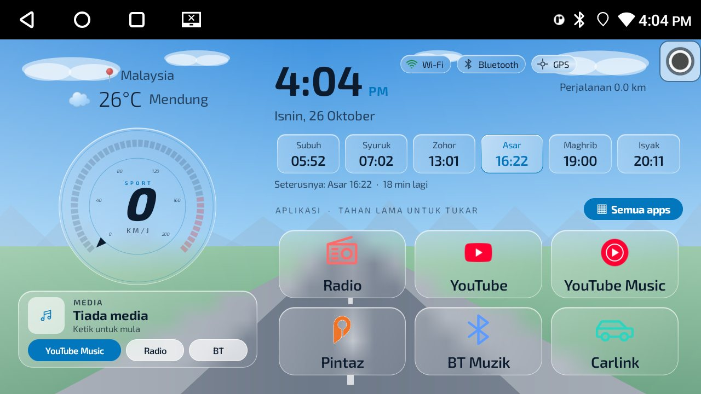 | |

Reka bentuk pratonton (dibuat dalam [design/home.html](design/home.html), boleh dibuka dalam pelayar):

| Tema Sport | Tema Hijau | Latar |
|---|---|---|
| 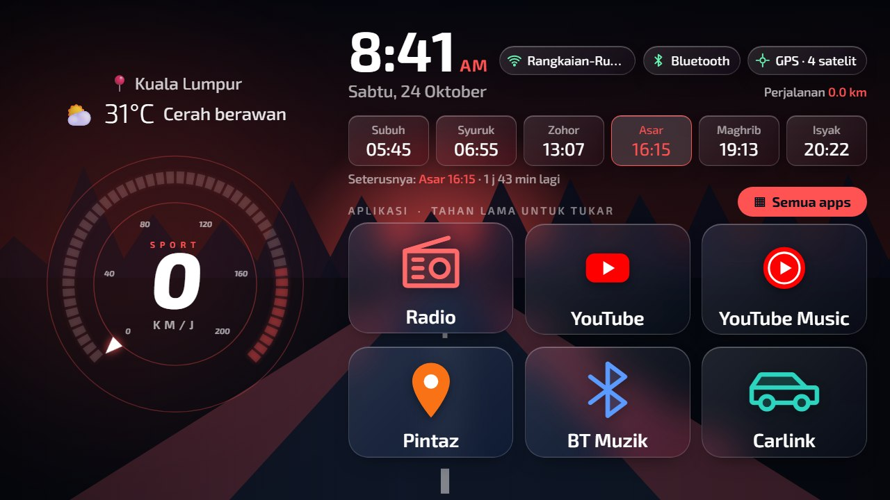 | 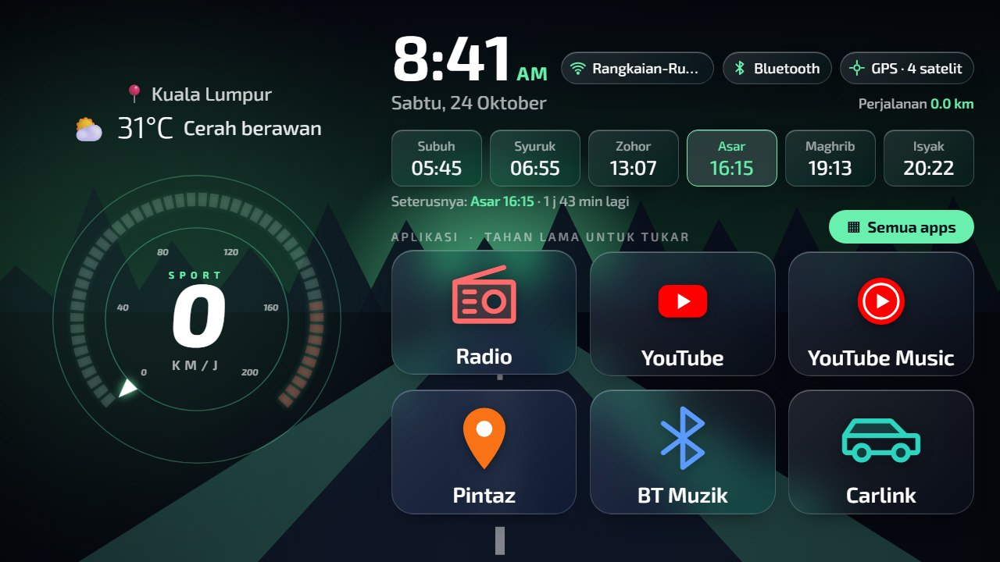 | 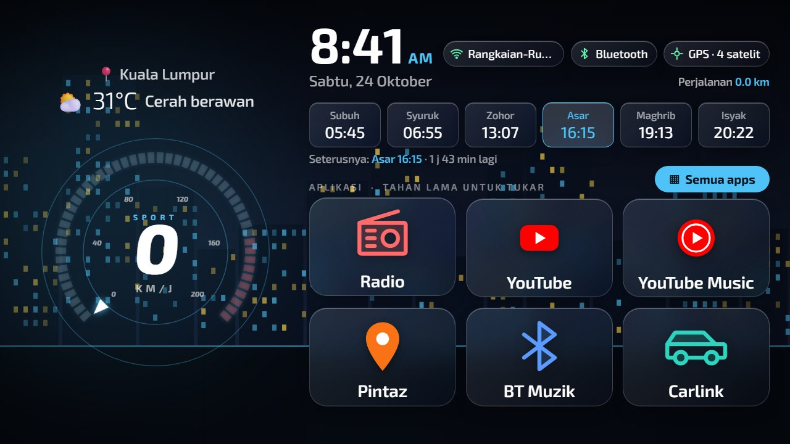 |
| 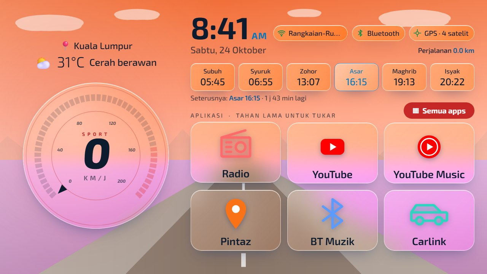 | 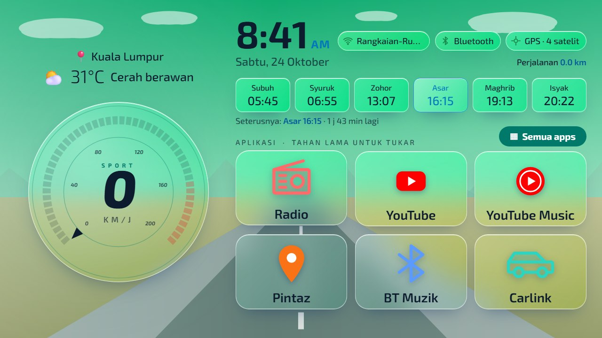 | 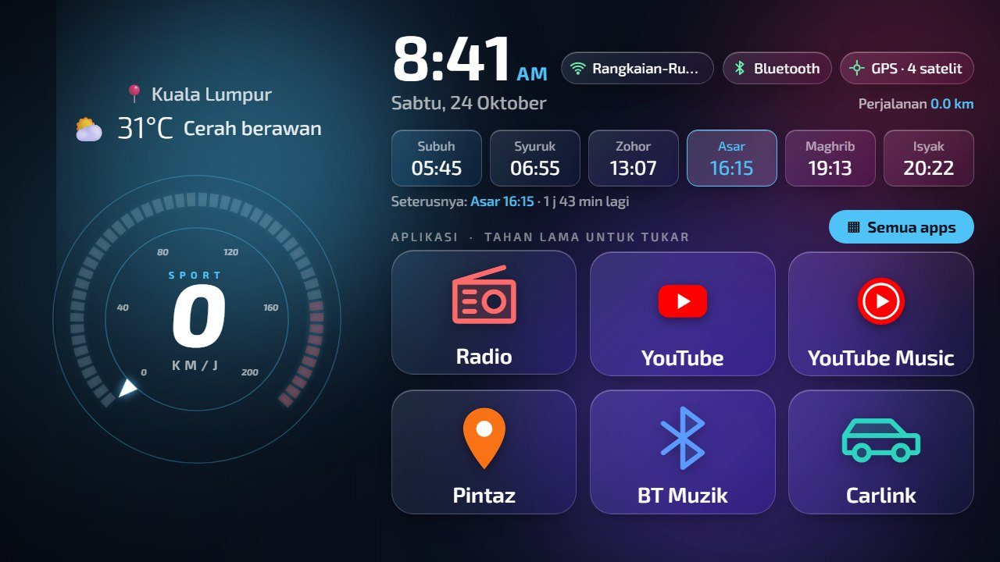 |

Lagi latar: [pantai](docs/images/design/latar-pantai.jpg), [gunung](docs/images/design/latar-gunung.jpg),
[neon](docs/images/design/latar-neon.jpg), [hutan](docs/images/design/latar-hutan.jpg),
[bokeh](docs/images/design/latar-bokeh.jpg), [hujan siang](docs/images/design/hujan-siang.jpg).

## Ciri-ciri

- **Speedometer** 50 segmen dengan zon merah, jarum penanda dan nombor condong (kelajuan daripada GPS unit).
- **Jam** tebal, mengikut tetapan 12/24 jam sistem, tarikh dalam Bahasa Melayu.
- **Waktu solat** dikira dalam app (tanpa internet) menggunakan lokasi GPS: Subuh/Isyak 18°, Asar mazhab Syafie.
  Anggaran sahaja; rujuk JAKIM untuk waktu rasmi.
- **Cuaca dan nama tempat** melalui Open-Meteo dan OpenStreetMap, dikemas kini setiap 30 minit bila ada internet. App juga meminta kedudukan rangkaian baharu setiap 5 minit
  (Android jarang menghantarnya sendiri bila disambung ke hotspot). **Ketik teks "Lokasi dikemas kini HH:mm"** di bawah cuaca (atau tahan lama suhu) untuk menyegarkan lokasi dan cuaca serta-merta.
  Tanpa GPS dan dengan hotspot, lokasi rangkaian boleh tersasar: **ketik nama tempat** (paling atas kiri) untuk menaip
  tempat sendiri (dicari melalui Nominatim, Malaysia sahaja). Ia kekal sehingga anda pilih "Automatik" atau GPS dapat
  isyarat.
- **Penanda status:** nama Wi-Fi, Bluetooth, GPS (jumlah satelit). Tekan untuk buka tetapan.
- **Enam app** di skrin utama. **Tahan lama** untuk tukar; **Semua apps** untuk senarai penuh. Ikon diambil terus daripada app.
- **Kaca berkabur** (kabur dibuat daripada latar kerana Android 11 tiada kabur langsung) dan ikon tanpa petak latar.
- **Siang / malam** dengan pudar sekitar Syuruk dan Maghrib; **hujan** bila cuaca menunjukkan hujan.
- **Splash** pendek (sekitar 1.3 saat) bila app dimulakan atau unit bangun.
- **Kad media** di bawah speedometer: tajuk, artis, kulit album, bar kemajuan dan butang sebelumnya/main/seterusnya
  untuk YouTube Music, YouTube dan Bluetooth muzik. Bila tiada media, kad menunjukkan pintasan YouTube Music, Radio
  dan BT. Perlu *Notification access* untuk Car Glass (sekali sahaja): Tetapan, atau
  `.\tools\install.ps1 -Device ... -MediaAccess`. Kawalan radio hanya jika app radio unit menyiarkan sesi media.
- **Butang "Kemaskini apps"** dalam senarai Semua apps: satu ketik ke Play Store untuk kemas kini manual
  (kemas kini automatik sebaiknya dimatikan supaya unit tidak tersekat; lihat Fasa 6 dalam [AGENTS.md](AGENTS.md)).
- **Audit RAM:** `tools\ram-audit.ps1` menunjukkan proses berat dan app yang jarang digunakan (hanya membaca).
- **Log GPS** (`gps-log.csv`, masa dan kelajuan sahaja, tanpa koordinat) untuk mencari punca kelewatan GPS.

## Bagaimana kod berfungsi

Java biasa, tanpa pustaka luar (`app/src/main/java/my/carglass/`). Semua dilukis dengan `Canvas`, jadi ringan
untuk unit 2 GB RAM.

| Fail | Tugas |
|---|---|
| `MainActivity` | Skrin utama: susun atur, tema siang/malam, enam kotak app, laci Semua apps, lokasi GPS dan rangkaian, pengait ujian ADB |
| `SpeedometerView` | Speedometer 50 segmen, zon merah, jarum, nombor condong |
| `BackgroundView`, `GlassDrawable` | Latar dan kaca: kabur dibuat lebih awal daripada latar (Android 11 tiada kabur langsung) |
| `MediaCard`, `MediaWatcher`, `MediaAccess` | Kad media: ikut sesi media yang aktif (MediaSession), lukis kad dan butang; `MediaAccess` ialah pendengar notifikasi kosong yang diperlukan Android untuk akses itu |
| `RainView` | Efek titisan hujan |
| `SplashView` | Splash NEXUP sekitar 1.3 saat |
| `PrayerTimes` | Waktu solat dikira dalam app (Subuh/Isyak 18°, Asar mazhab Syafie), tanpa internet |
| `WeatherClient` | Cuaca (Open-Meteo) dan nama tempat (Nominatim) |
| `Icons`, `Fonts` | Ikon app asal (adaptive icon) dan Exo 2 |
| `GpsLog` | `gps-log.csv` (masa dan kelajuan sahaja) |

Direktori lain: `design/` (pratonton web), `tools/` (skrip PowerShell: sambung, semak, pasang, pulih, tangkap skrin,
audit RAM, Pakej Ringan), `docs/` (unit diuji, pembangunan, penyelesaian masalah).

### Alat tambahan

- `tools\ram-audit.ps1`: audit RAM, hanya membaca.
- `tools\lighten.ps1 -Apply|-Restore`: **Pakej Ringan** (animasi 0.5x, hadkan latar belakang Play Store/Chrome,
  lumpuhkan app sisa persediaan awal). Pada unit Mohawk 2 GB: RAM bebas +~160 MB, masa mula 2-9% lebih pantas.
  Boleh dipulihkan.
- Melumpuhkan launcher asal (pilihan, hanya jika Home asal sering muncul): pulih dengan `tools\revert.ps1`
  sahaja (ADB). Butang "Launcher stok" di Semua apps hanya berfungsi selagi launcher asal masih aktif.

## Apa yang diperlukan

| Perkara | Keperluan |
|---|---|
| Unit | Android 9+ (minSdk 28), skrin landskap, GPS, kebenaran memasang APK |
| Komputer | Windows 10/11 dengan PowerShell, `adb` (Android platform-tools) |
| Rangkaian | Komputer dan unit di Wi-Fi yang sama (untuk ADB wayarles) |
| Kata laluan | Banyak unit mengunci *Developer options*. Anda perlu kod daripada pembekal. **Jangan cuba memintasnya.** |

## Pasang dengan pembantu AI (disyorkan)

1. Buka folder ini dalam Claude Code (atau pembantu AI yang boleh menjalankan arahan).
2. Salin arahan dalam [PROMPT.md](PROMPT.md) dan gantikan maklumat unit anda.
3. Pembantu mengikut [AGENTS.md](AGENTS.md): semak dahulu, sandar, tanya sebelum setiap perubahan.

## Pasang secara manual

```powershell
# 1. Sambung (ganti IP:port daripada skrin Wireless debugging; -PairWith jika diminta kod 6 digit)
.\tools\connect.ps1 -Target 192.168.1.50:41569

# 2. Semak unit dan sandar. Tidak mengubah apa-apa selain menulis folder backup\
.\tools\preflight.ps1 -Device 192.168.1.50:41569

# 3. Bina APK (JDK 17 + Android SDK) atau guna APK yang anda ada
.\gradlew.bat assembleDebug

# 4. Pasang dan buka (belum jadi Home)
.\tools\install.ps1 -Device 192.168.1.50:41569

# 5. Selepas anda berpuas hati, jadikan Home lalai
.\tools\install.ps1 -Device 192.168.1.50:41569 -SetHome

# Kembali ke Home asal bila-bila masa
.\tools\revert.ps1 -Device 192.168.1.50:41569
```

Port ADB wayarles bertukar setiap kali unit dihidupkan semula, jadi dapatkan port baharu pada skrin unit.

## Tukar app di skrin utama

Tahan satu kotak app selama kira-kira setengah saat, kemudian pilih app pengganti. Pilihan disimpan.

## Bina daripada kod

Keperluan: JDK 17 dan Android SDK (platform 34, build-tools 34). Lihat [docs/DEVELOPING.md](docs/DEVELOPING.md).

## Privasi

- App tidak ada akaun, analitik atau iklan.
- Rangkaian digunakan hanya untuk cuaca (`api.open-meteo.com`) dan nama tempat (`nominatim.openstreetmap.org`),
  menghantar koordinat anda. Tanpa internet, bahagian itu menunjukkan data terakhir yang disimpan.
- Nama Wi-Fi dan nama tempat dipaparkan di skrin. Sebelum berkongsi tangkap skrin atau video, **tahan lama** penanda
  Wi-Fi (sembunyi nama) dan nama tempat (papar "Malaysia"). Tahan sekali lagi untuk memaparkannya semula.

## Kredit dan lesen

- Kod: MIT (lihat [LICENSE](LICENSE)). Nama dan logo NEXUP dalam splash ialah jenama pemilik dan tidak termasuk dalam lesen.
- Font **Exo 2**: SIL Open Font License 1.1 ([licenses/OFL-Exo2.txt](licenses/OFL-Exo2.txt)).
- Ikon duotone Radio, Bluetooth, Muzik, Navigasi, Video, Carlink, Fail, Galeri dan Tetapan: [Phosphor Icons](https://phosphoricons.com), MIT ([licenses/PHOSPHOR-LICENSE.txt](licenses/PHOSPHOR-LICENSE.txt)).
- Cuaca: [Open-Meteo](https://open-meteo.com) (penggunaan bukan komersial, dengan atribusi).
- Nama tempat dan data peta: © pengeluar sumbangan [OpenStreetMap](https://www.openstreetmap.org/copyright) (ODbL), melalui Nominatim.
- Konsep repo yang boleh dipasang oleh pembantu AI diilhamkan oleh [Glass TV](https://github.com/cocombee/glass-tv). Tiada kod disalin.
